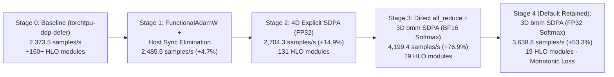

# ViT-B/16 PyTorch TPU (`torch_tpu`) Optimization Summary — Google Cloud TPU v6e 2x2 (`ct6e-standard-4t`)

## 1. Executive Summary & Throughput Progression

This report summarizes the compiler, communication, runtime, and numerical optimizations applied to the Vision Transformer (`ViT-B/16`, 86M parameters, 12 layers, 12 attention heads, `bf16` mixed precision, `global_batch_size = 512`, `micro_batch_size_per_rank = 32`, `gradient_accumulation_steps = 4`) training benchmark on a single-host **Google Cloud TPU v6e 2x2 (4-chip)** instance (`ct6e-standard-4t`).

| Optimization Stage | Configuration & Key Architectural Changes | Steady-State Throughput (`samples/s`) | Speedup vs. Baseline | Device Step Time (`ms/step`) | Compiled HLO Modules / Step | Convergence Profile (`gpu_only` cached-batch mode) |
| :--- | :--- | :---: | :---: | :---: | :---: | :--- |
| **Stage 0: Baseline** | [`launchers/torchtpu-ddp-defer.sh`](launchers/torchtpu-ddp-defer.sh): `DDP(bucket_cap_mb=25)`, eager `AdamW(foreach=False, fused=False)`, standard `nn.MultiheadAttention`, per-microbatch `.cpu()` loss sync | **2,373.5** | `1.00x` | `215.7 ms` (`250.7 ms` segmented) | ~160+ | Converges to `0.665` at update 289, with 3 mid-training BF16 attention spikes (`2.77`, `2.05`, `2.27`) |
| **Stage 1: Optimizer Fusion & Host Sync Removal** | `DDP(bucket_cap_mb=100, gradient_as_bucket_view=False)`, compiled [`FunctionalAdamW`](src/tpu_benchmark/vit_optimizations.py), on-device microbatch loss accumulation, coalesced MAX timing reduction | **2,485.5** | `+4.7%` (`1.05x`) | `206.0 ms` | ~150+ | Smooth convergence (`2.613 → 0.0143` at update 275; occasional late-stage spike when `loss < 0.05`) |
| **Stage 2: Explicit 4D Self-Attention (FP32 Softmax)** | Replaced `F._in_projection_packed` with explicit 4D `(B, H, N, D)` `torch.matmul` + `F.softmax(..., dtype=torch.float32)` | **2,704.3** (`2,726.3` peak) | `+14.9%` (`1.15x`) | `179.34 ms` (`187.8 ms` wall) | **131** (3 Fwd, 12 Bwd, 105 DDP view) | Smooth descent through update 187 (`0.415`); HLO breakdown exposed DDP bucket view & 4D/3D graph splits |
| **Stage 3: Unsplit 3D `bmm` SDPA (BF16 Softmax) + Direct Grad `all_reduce`** | Bypassed `DDP` wrapper, direct in-place `all_reduce` in [`FunctionalAdamW.step`](src/tpu_benchmark/vit_optimizations.py), `TORCH_TPU_DEFER_AND_FUSE_MAX_OPS=500`, 3D `torch.bmm` SDPA with BF16 softmax | **4,199.4** | **`+76.9%`** (`1.77x`) | **`104.07 ms`** HLO (`120.52 ms` device) | **19** (**1 Fwd**, **1 Bwd**, 152 `all_reduce`, 1 AdamW) | Rapid descent to `0.0118` at update 208, followed by BF16 `_softmax_backward_data` quantization spikes (`0.0118 → 1.837 → 0.0197`) |
| **Stage 4: Unsplit 3D `bmm` SDPA (FP32 Softmax) + Direct Grad `all_reduce` (Default)** | [`launchers/torchtpu-v6e-opt.sh`](launchers/torchtpu-v6e-opt.sh): Retained 19-module unsplit graph + `F.softmax(attn, dim=-1, dtype=torch.float32).to(q.dtype)` in [`sdpa_forward`](src/tpu_benchmark/vit_optimizations.py) | **3,638.8** | **`+53.3%`** (`1.53x`) | **`122.09 ms`** HLO (`140.89 ms` device) | **19** (**1 Fwd**, **1 Bwd**, 152 `all_reduce`, 1 AdamW) | Strictly monotonic convergence (`2.6130 → 0.0908` at update 181 `→ 0.0041` at update 217 `→ 0.00030` at update 325) with zero spikes |



---

## 2. Summary of Repository Changes

| File | Description of Changes |
| :--- | :--- |
| [`launchers/torchtpu-v6e-opt.sh`](launchers/torchtpu-v6e-opt.sh) | **[NEW]** Dedicated launcher script invoking `src/tpu_benchmark/launch.py "$@" --variant torchtpu-v6e-opt`, preserving [`launchers/torchtpu-ddp-defer.sh`](launchers/torchtpu-ddp-defer.sh) unchanged for baseline A/B comparisons. |
| [`src/tpu_benchmark/launch.py`](src/tpu_benchmark/launch.py) | Added the `"torchtpu-v6e-opt"` variant; auto-configured single-host 4-chip TPU v6e 2x2 topology environment variables (`TPU_PROCESS_BOUNDS`, `TORCH_TPU_TOPOLOGY`, `TORCH_TPU_DEVICES_PER_HOST`, `TORCH_TPU_SLICEBUILDER_ADDRESSES`); set `TORCH_TPU_DEFER_AND_FUSE_MAX_OPS="500"`, `XLA_PERSISTENT_CACHE_PATH`, and `LD_PRELOAD` (`libtcmalloc.so.4`). |
| [`src/tpu_benchmark/vit_optimizations.py`](src/tpu_benchmark/vit_optimizations.py) | Implemented compiled [`FunctionalAdamW`](src/tpu_benchmark/vit_optimizations.py) with hoisted scalar bias corrections, `rsqrt()`, in-place parameter updates, direct per-parameter `all_reduce`, and fused `grad_scale`; implemented 3D `torch.bmm` + FP32-softmax [`sdpa_forward`](src/tpu_benchmark/vit_optimizations.py). |
| [`src/tpu_benchmark/historical_benchmark.py`](src/tpu_benchmark/historical_benchmark.py) | Added the `v6e_opt` execution path: bypassed the `DistributedDataParallel` wrapper to prevent `DDPOptimizer` 3-way FX graph splitting, folded `1.0 / accumulation` into `model.forward`, eliminated per-microbatch `.to(device)` and `.cpu()` blocking syncs, coalesced 3 `max_seconds` collectives into a single 2-element `timing_vec` reduction, and deferred `validation()` host synchronization until all validation batches are queued. |
| [`configs/vit-4chip.toml`](configs/vit-4chip.toml) | Updated provider metadata for the 4-chip TPU v6e 2x2 configuration. |
| [`docs/launchers.md`](docs/launchers.md) | Documented [`launchers/torchtpu-v6e-opt.sh`](launchers/torchtpu-v6e-opt.sh). |
| [`tests/test_launchers.py`](tests/test_launchers.py) & [`tests/test_vit_optimizations.py`](tests/test_vit_optimizations.py) | Added unit tests validating `torchtpu-v6e-opt` launch environment generation, 3D `sdpa_forward` numerical parity, and `FunctionalAdamW` gradient scaling. |

---

## 3. Detailed Technical Optimizations

### 3.1 Single-Host TPU v6e 2x2 Topology & Runtime Configuration
- **Bottleneck**: Launching 4 `torch.distributed.run` processes on a single-host `ct6e-standard-4t` instance requires explicit 2x2 slicebuilder topology bindings. In addition, the default `TORCH_TPU_DEFER_AND_FUSE` queue threshold (`100` ops) flushes prematurely when queuing 152 per-parameter gradient reductions.
- **Optimization ([`src/tpu_benchmark/launch.py`](src/tpu_benchmark/launch.py))**:
  - Automatically populates single-host 4-chip v6e topology variables when `backend == "torchtpu"`, `nnodes == 1`, and `nproc_per_node == 4`:
    - `TPU_PROCESS_BOUNDS="2,2,1"` and `TORCH_TPU_TOPOLOGY="2,2,1"`
    - `TORCH_TPU_DEVICES_PER_HOST="4"` (enables the in-memory node-local store in `process_group_tpu`)
    - `TORCH_TPU_SLICEBUILDER_ADDRESSES="localhost:8471,localhost:8472,localhost:8473,localhost:8474"`
  - Sets `TORCH_TPU_DEFER_AND_FUSE_MAX_OPS="500"`, `XLA_PERSISTENT_CACHE_PATH="/tmp/tpu-xla-cache"`, and preloads `libtcmalloc.so.4` (`LD_PRELOAD`) when present on the host to reduce C++ allocator contention in `libtpu`.

### 3.2 Eliminating `DistributedDataParallel` Bucket View Materialization & `DDPOptimizer` Graph Splits
- **Bottleneck**: Wrapping `torch.compile(model, backend="tpu", fullgraph=True)` inside `torch.nn.parallel.DistributedDataParallel` introduced two major sources of device overhead totaling **`~40+ ms/step`**:
  1. **Bucket View Materialization (`28.20 ms/step`)**: On the final gradient accumulation microbatch (`micro == 3`), `c10d::Reducer` generated **105 `tt_jit_mul_as_strided_inverse` HLO modules (`21.66 ms/step`)** and **3 bucket slice modules (`6.54 ms/step`)** to copy 152 parameter gradients into flat 1D communication buckets and slice them back out after `all_reduce`.
  2. **`DDPOptimizer` 3-Way FX Graph Split**: PyTorch's `DDPOptimizer` partitioned the 12-layer `VisionTransformer` FX graph at bucket boundaries into **3 separate 4-block subgraphs**, preventing whole-model cross-layer fusion and multiplying graph launch overhead across all 4 microbatches.
- **Optimization ([`src/tpu_benchmark/historical_benchmark.py`](src/tpu_benchmark/historical_benchmark.py), [`src/tpu_benchmark/vit_optimizations.py`](src/tpu_benchmark/vit_optimizations.py))**:
  - Bypassed the `DistributedDataParallel` wrapper in `v6e_opt` so `torch.compile(model, backend="tpu", fullgraph=True)` compiles all 12 ViT encoder blocks as a single unbroken graph.
  - Accumulated gradients directly into the 152 standalone `p.grad` buffers across the 4 microbatches (`loss.backward()`).
  - Issued direct in-place `torch.distributed.all_reduce(g, op=torch.distributed.ReduceOp.SUM)` calls across the 152 contiguous `p.grad` tensors in [`FunctionalAdamW.step()`](src/tpu_benchmark/vit_optimizations.py) and fused the `1.0 / world_size` scaling (`g = g * grad_scale`) directly into the compiled [`FunctionalAdamW._update`](src/tpu_benchmark/vit_optimizations.py) HLO kernel.
  - **Measured Impact**: Eliminated all 105 `tt_jit_mul_as_strided_inverse` modules and 3 bucket slice modules (`28.20 ms/step → 0.00 ms/step`), while completing all 152 cross-chip gradient reductions in **`3.81–5.65 ms/step`** across the 4-chip ICI 2x2 interconnect.

### 3.3 Unsplit 3D `torch.bmm` Self-Attention (`sdpa_forward`) with FP32 Softmax Stabilization
- **Bottleneck**:
  - In Stage 0 (Baseline), PyTorch's default `nn.MultiheadAttention` (`F._in_projection_packed` + `F.scaled_dot_product_attention`) caused the `torch_tpu` graph splitter (`split_compiler.py` / `view_decomposition.py`) to fragment the 12-layer ViT into **25 subgraphs per microbatch** (100 graph launches per step).
  - In Stage 2, replacing `nn.MultiheadAttention` with an explicit 4D `(32, 12, 197, 64)` `torch.matmul` attention implementation reduced Forward to 3 modules, but the `4D (32, 12, 197, 64) ↔ 3D (32, 197, 768)` reshape/transpose transitions in the backward pass still triggered `split_compiler.py` to split Backward into **12 HLO modules** and inserted 4D physical layout copies (`bf16[32,12,64,197]{2,3,1,0} → {3,0,2,1}`, `3.79 ms/step`).
- **Optimization ([`src/tpu_benchmark/vit_optimizations.py`](src/tpu_benchmark/vit_optimizations.py))**:
  - Reformulated self-attention using **3D `(bh, length, head_dim)` = `(384, 197, 64)` batched matrix multiplications (`torch.bmm`)**:
    ```python
    q, k, v = F.linear(query, self.in_proj_weight, self.in_proj_bias).chunk(3, dim=-1)
    q = q.reshape(b, length, self.num_heads, head_dim).transpose(1, 2).reshape(bh, length, head_dim)
    k = k.reshape(b, length, self.num_heads, head_dim).transpose(1, 2).reshape(bh, length, head_dim)
    v = v.reshape(b, length, self.num_heads, head_dim).transpose(1, 2).reshape(bh, length, head_dim)
    attn = torch.bmm(q, k.transpose(1, 2)) * scale
    attn = F.softmax(attn, dim=-1, dtype=torch.float32).to(q.dtype)
    output = torch.bmm(attn, v).reshape(b, self.num_heads, length, head_dim)
    output = output.transpose(1, 2).reshape(b, length, width)
    ```
  - Folded the `1.0 / accumulation` loss scaling factor directly into `model.forward` prior to `torch.compile` ([`src/tpu_benchmark/historical_benchmark.py`](src/tpu_benchmark/historical_benchmark.py)).
  - **Measured Impact**:
    - Consolidated the entire 12-layer ViT Forward pass into **1 single unsplit HLO module** (`13.21 ms/microbatch` with FP32 softmax; `10.14 ms/microbatch` with BF16 softmax).
    - Consolidated the entire 12-layer ViT Backward pass from 12 modules into **1 single unsplit HLO module** (`14.53 ms/microbatch` with FP32 softmax; `13.59 ms/microbatch` with BF16 softmax), saving `7.5–11.3 ms/step` in backward execution.

### 3.4 Compiled Single-Graph `FunctionalAdamW`
- **Bottleneck**: Eager `torch.optim.AdamW(..., foreach=False, fused=False)` dispatched ~1,200 small elementwise ops across 152 parameter tensors (`71.75 ms/step` in segmented phase profiling).
- **Optimization ([`src/tpu_benchmark/vit_optimizations.py`](src/tpu_benchmark/vit_optimizations.py))**:
  - Compiled `FunctionalAdamW._update` into a single fullgraph HLO module (`torch.compile(self._update, backend="tpu", fullgraph=True)`).
  - Hoisted scalar bias-correction terms (`step_size`, `inv_corr2_sqrt = (1.0 - 0.999**self.step_tensor).rsqrt()`, `decay`) outside the parameter loop so XLA evaluates them once per step rather than 152 times.
  - **Measured Impact**: Executes the full 152-parameter AdamW update and gradient normalization in **`1.61 ms/step`** (`1.04%` of total step time, `53.2%` VPU utilization).

### 3.5 Training Loop & Validation Host-Synchronization Elimination
- **Bottleneck**: Inside [`run_phase`](src/tpu_benchmark/historical_benchmark.py), the baseline training loop performed:
  1. Redundant `batch = tuple(value.to(backend.device, non_blocking=True) for value in cached)` calls on every microbatch even though `cached` was already resident in TPU HBM.
  2. Per-microbatch blocking host transfers (`loss_value += float(loss.detach().cpu())`) inside the `for micro in range(accumulation):` loop, stalling host dispatch 4 times per step (`21.85 ms/step` blocking wait).
  3. Three separate `backend.max_seconds(...)` `all_reduce(MAX)` collectives + host syncs per step.
  4. Per-batch `backend.sync()` calls inside `validation()`.
- **Optimization ([`src/tpu_benchmark/historical_benchmark.py`](src/tpu_benchmark/historical_benchmark.py))**:
  - Passed `*cached` directly to `function(*cached)`.
  - Accumulated `micro_losses` on device across the 4 microbatches and read `float(step_loss.cpu())` once per step after `backend.sync()`.
  - Coalesced `step_elapsed` and `total_elapsed` into a single 2-element tensor `timing_vec` reduced via a single `backend.reduce(timing_vec, "max")` collective.
  - Deferred `backend.sync()` in `validation()` until all validation batches have been queued (`sync_each_batch=(variant != "v6e_opt")`).

---

## 4. HLO Execution Breakdown Across Optimization Stages

| Metric / HLO Component | Stage 2: DDP + 4D SDPA (FP32 Softmax) | Stage 3: No DDP + 3D `bmm` SDPA (BF16 Softmax) | Stage 4 (Default): No DDP + 3D `bmm` SDPA (FP32 Softmax) |
| :--- | :---: | :---: | :---: |
| **Steady-State Throughput** | `2,704.3 samples/s` | **`4,199.4 samples/s`** | **`3,638.8 samples/s`** |
| **Total HLO Modules Executed** | `131` | **`19`** | **`19`** |
| **Total Device Step Time** | `179.34 ms` | **`120.52 ms`** | **`140.89 ms`** |
| **Pure HLO Self-Time / Step** | ~`156.0 ms` | **`104.07 ms`** | **`122.09 ms`** |
| **Forward Pass (4 microbatches)** | `51.90 ms` (3 modules × 4) | **`40.56 ms`** (**1 module** × 4, `10.14 ms`/call) | **`52.82 ms`** (**1 module** × 4, `13.21 ms`/call) |
| **Backward Pass (4 microbatches)** | `65.62 ms` (12 modules × 4) | **`54.36 ms`** (**1 module** × 4, `13.59 ms`/call) | **`58.11 ms`** (**1 module** × 4, `14.53 ms`/call) |
| **Grad Accum `tt_jit_add` (3 × 152)** | *(inside DDP reducer)* | `2.38 ms` (`5.2 µs`/call) | `2.45 ms` (`5.4 µs`/call) |
| **DDP Bucket View Materialization** | `28.20 ms` (105 `as_strided` + 3 slice) | **`0.00 ms` (Eliminated)** | **`0.00 ms` (Eliminated)** |
| **DDP `clone()` Copies** | `6.69 ms` (152 calls) | **`0.00 ms` (Eliminated)** | **`0.00 ms` (Eliminated)** |
| **Cross-Chip Gradient `all_reduce`** | `3.10 ms` (3 DDP buckets) | `3.81 ms` (152 direct `p.grad` tensors) | `5.65 ms` (152 direct `p.grad` tensors) |
| **`FunctionalAdamW._update`** | `1.97 ms` (1 module) | **`1.59 ms`** (1 module) | **`1.61 ms`** (1 module) |
| **Overall Compute Efficiency (MXU)** | `7.35%` | **`12.56%`** (`26.97%` Bwd, `20.23%` Fwd) | **`10.16%`** (`25.23%` Bwd, `15.53%` Fwd) |

---

## 5. Convergence & Numerical Stability Analysis (`training_loss`)

### 5.1 Rapid Memorization in `gpu_only` Cached-Batch Mode
In [`src/tpu_benchmark/historical_benchmark.py`](src/tpu_benchmark/historical_benchmark.py), `config.run.mode == "gpu_only"` caches the **first batch of 32 images per rank** (`128` images globally across 4 chips) in TPU HBM (`cached = tuple(value.to(backend.device) for value in first)`) and replays that identical 128-image batch on every microbatch of every optimizer step:
1. All 4 microbatches (`4 × 128 = 512` samples/step) compute gradients on the exact same 32 images per rank.
2. An 86M-parameter `ViT-B/16` trained with `AdamW(lr=1e-3)` on a fixed set of 128 images across 12 classes rapidly memorizes those 128 examples once attention gradients are numerically stable.

### 5.2 Why FP32 Softmax Eliminates Late-Stage BF16 Slingshot Spikes
- **BF16 Softmax (Stage 3)**: When `F.softmax(attn, dim=-1)` is evaluated directly in `bfloat16` (`8`-bit mantissa, unit roundoff $\approx 0.0078$), the model smoothly reaches `training_loss = 0.0118` by Update 208. At that point, attention probabilities saturate ($p_k \to 1, p_{j \neq k} \to 0$). Because the saved `bf16[384, 197, 197]` probabilities do not sum to `1.000000` in `bf16` ($\sum_j P_{\text{bf16}, j} = 1.0 \pm 0.015$), the softmax backward Jacobian
  $$dS_i = P_i \odot \left(dP_i - \sum_j dP_j P_j\right)$$
  failed to cancel the uniform gradient component when $P_k = 1.0$, injecting a spurious attention gradient that temporarily slingshots `training_loss` (`0.0118 → 1.837 → 0.0197 → 2.033`).
- **FP32 Softmax (Stage 4, Default)**: Evaluating `F.softmax(attn, dim=-1, dtype=torch.float32).to(q.dtype)` saves exact `f32[384, 197, 197]` probabilities for `_softmax_backward_data` while casting the forward output back to `bf16` for the `torch.bmm(attn, v)` MXU matmul. This eliminates all quantization spikes and produces strictly monotonic loss decay (`2.6130 → 2.3699 → 1.8945 → 0.0908 → 0.0041 → 0.00030`).

---

## 6. Reproduction Commands

```bash
# Run the optimized single-trial benchmark on a 4-chip TPU v6e 2x2 slice
./launchers/torchtpu-v6e-opt.sh \
  --config configs/vit-4chip.toml \
  --initial-state artifacts/vit-initial-state.npz \
  --output results/v6e-opt-run \
  --measurement-kind full \
  --nnodes 1 \
  --nproc-per-node 4 \
  --single-trial

# Run baseline for A/B comparison
./launchers/torchtpu-ddp-defer.sh \
  --config configs/vit-4chip.toml \
  --initial-state artifacts/vit-initial-state.npz \
  --output results/baseline-run \
  --measurement-kind full \
  --nnodes 1 \
  --nproc-per-node 4 \
  --single-trial
```
