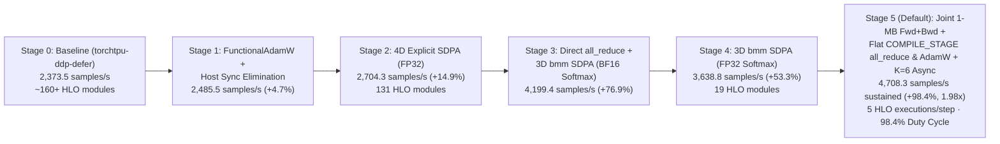

# ViT-B/16 PyTorch TPU (`torch_tpu`) Optimization Summary — Google Cloud TPU v6e 2x2 (`ct6e-standard-4t`)

## 1. Executive Summary & Throughput Progression

This report summarizes the compiler, communication, runtime, and numerical optimizations applied to the Vision Transformer (`ViT-B/16`, 85.8M parameters, 12 layers, 12 attention heads, `bf16` mixed precision, `global_batch_size = 512`, `micro_batch_size_per_rank = 32`, `gradient_accumulation_steps = 4`) training benchmark on a single-host **Google Cloud TPU v6e 2x2 (4-chip)** instance (`ct6e-standard-4t`).

| Optimization Stage | Configuration & Key Architectural Changes | Throughput (`samples/s`) | Speedup vs. Baseline | Device Step Time (`ms/step`) | Compiled HLO Executions / Step | Convergence & Holdout Profile (`gpu_only` cached-batch mode) |
| :--- | :--- | :---: | :---: | :---: | :---: | :--- |
| **Stage 0: Baseline** | [`launchers/torchtpu-ddp-defer.sh`](launchers/torchtpu-ddp-defer.sh): `DDP(bucket_cap_mb=25)`, eager `AdamW(foreach=False, fused=False)`, standard `nn.MultiheadAttention`, per-microbatch `.cpu()` loss sync | **2,373.5** | `1.00x` | `215.7 ms` (`250.7 ms` segmented) | ~160+ | Reaches `0.665` at update 289, with 3 mid-training attention bounces (`2.77`, `2.05`, `2.27`) |
| **Stage 1: Optimizer Fusion & Host Sync Removal** | `DDP(bucket_cap_mb=100, gradient_as_bucket_view=False)`, compiled [`FunctionalAdamW`](src/tpu_benchmark/vit_optimizations.py), on-device microbatch loss accumulation, coalesced MAX timing reduction | **2,485.5** | `+4.7%` (`1.05x`) | `206.0 ms` | ~150+ | Smooth descent (`2.613 → 0.0143` at update 275; occasional late-stage bounce when `loss < 0.05`) |
| **Stage 2: Explicit 4D Self-Attention (FP32 Softmax)** | Replaced `F._in_projection_packed` with explicit 4D `(B, H, N, D)` `torch.matmul` + `F.softmax(..., dtype=torch.float32)` | **2,704.3** (`2,726.3` peak) | `+14.9%` (`1.15x`) | `179.34 ms` (`187.8 ms` wall) | **131** (3 Fwd, 12 Bwd, 105 DDP view) | Reaches `0.0020` at update 565; HLO breakdown exposed DDP bucket view & 4D/3D graph splits |
| **Stage 3: Unsplit 3D `bmm` SDPA (BF16 Softmax) + Direct Grad `all_reduce`** | Bypassed `DDP` wrapper, direct in-place `all_reduce` in [`FunctionalAdamW.step`](src/tpu_benchmark/vit_optimizations.py), `TORCH_TPU_DEFER_AND_FUSE_MAX_OPS=500`, 3D `torch.bmm` SDPA with BF16 softmax | **4,199.4** | `+76.9%` (`1.77x`) | `104.07 ms` HLO (`120.52 ms` device) | **19** (4× Fwd, 4× Bwd, 152 `all_reduce`, 1 AdamW) | Rapid descent to `0.0118` at update 208, followed by BF16 `_softmax_backward_data` quantization spikes (`0.0118 → 1.837 → 0.0197`) |
| **Stage 4: Unsplit 3D `bmm` SDPA (FP32 Softmax) + Direct Grad `all_reduce`** | [`launchers/torchtpu-combined.sh`](launchers/torchtpu-combined.sh): Retained 19-module unsplit graph + `F.softmax(attn, dim=-1, dtype=torch.float32).to(q.dtype)` in [`sdpa_forward`](src/tpu_benchmark/vit_optimizations.py) | **3,638.8** | `+53.3%` (`1.53x`) | `122.09 ms` HLO (`140.89 ms` device) | **19** (4× Fwd, 4× Bwd, 152 `all_reduce`, 1 AdamW) | Monotonic convergence (`2.6130 → 0.0908` at update 181 `→ 0.00030` at update 325) |
| **Stage 5: Cached 1-MB Joint Fwd+Bwd + Flat `COMPILE_STAGE` `all_reduce` & Out-of-Place AdamW + `K=6` Async (Default)** | [`launchers/torchtpu-v6e-opt.sh`](launchers/torchtpu-v6e-opt.sh): [`WholeStepRunner`](src/tpu_benchmark/vit_optimizations.py) (`make_fx` + `grad_and_value`), cached `bf16` working weights, 128-aligned flat `f32[85.8M]` `COMPILE_STAGE` `all_reduce` + out-of-place [`AlignedFlatAdamW`](src/tpu_benchmark/vit_optimizations.py), `TORCH_TPU_SYNC_INTERVAL=6` | **4,708.3** *(20-min sustained)* / **4,714.2** *(steady-state)* | **`+98.4%`** (`1.98x`–`1.99x`) | **`107.27 ms`** device (`108.02 ms` median / `108.22 ms` p95 wall) | **5** (**4×** joint 1-MB Fwd+Bwd+Pack, **1×** Accum+`all_reduce`+AdamW) | Converges `2.6130 → 0.00017` (@913) `→ 5.40e-7` (@11,041); 4,000-sample unseen holdout `validation_loss: 2.6310 → 1.1563` |



---

## 2. Summary of Repository Changes

| File | Description of Changes |
| :--- | :--- |
| [`launchers/torchtpu-v6e-opt.sh`](launchers/torchtpu-v6e-opt.sh) | **[NEW]** Dedicated launcher script invoking `src/tpu_benchmark/launch.py "$@" --variant torchtpu-v6e-opt`, preserving [`launchers/torchtpu-ddp-defer.sh`](launchers/torchtpu-ddp-defer.sh) unchanged for baseline A/B comparisons. |
| [`src/tpu_benchmark/launch.py`](src/tpu_benchmark/launch.py) | Added the `"torchtpu-v6e-opt"` variant; auto-configured single-host 4-chip TPU v6e 2x2 topology environment variables (`TPU_PROCESS_BOUNDS`, `TORCH_TPU_TOPOLOGY`, `TORCH_TPU_DEVICES_PER_HOST`, `TORCH_TPU_SLICEBUILDER_ADDRESSES`, startup `TORCH_TPU_SPMD_HANDSHAKE_STAGE="OFF"`); set `TORCH_TPU_DEFER_AND_FUSE_MAX_OPS="500"`, `XLA_PERSISTENT_CACHE_PATH`, `--xprof` forwarding, and `LD_PRELOAD` (`libtcmalloc`). |
| [`src/tpu_benchmark/vit_optimizations.py`](src/tpu_benchmark/vit_optimizations.py) | Implemented [`WholeStepRunner`](src/tpu_benchmark/vit_optimizations.py) with cross-phase `_COMPILED_V6E_CACHE` (`make_fx` + `torch.func.grad_and_value` 1-microbatch joint forward/backward/pack + compiled functional accumulation, `COMPILE_STAGE` flat 1D `all_reduce`, and out-of-place [`AlignedFlatAdamW`](src/tpu_benchmark/vit_optimizations.py) emitting cached `bf16` working weights), alongside [`FunctionalAdamW`](src/tpu_benchmark/vit_optimizations.py) and 3D `torch.bmm` FP32-softmax [`sdpa_forward`](src/tpu_benchmark/vit_optimizations.py). |
| [`src/tpu_benchmark/historical_benchmark.py`](src/tpu_benchmark/historical_benchmark.py) | Added the `v6e_opt` execution path: promoted `TORCH_TPU_SPMD_HANDSHAKE_STAGE="COMPILE_STAGE"` after `init_process_group`, drove [`WholeStepRunner`](src/tpu_benchmark/vit_optimizations.py) in bounded `TORCH_TPU_SYNC_INTERVAL=6` async bursts with zero per-step host blocking, synchronized master weights back into `nn.Module` via `runner.sync_model_parameters()` before `validation()`, and deferred validation host syncs until all validation batches are queued. |
| [`configs/vit-4chip.toml`](configs/vit-4chip.toml) | Preserved canonical workload hyperparameters (`micro_batch_size_per_rank = 32`, `global_batch_size = 512`, `lr = 0.001`, `weight_decay = 0.01`) with 4-chip TPU v6e 2x2 provider metadata. |
| [`docs/launchers.md`](docs/launchers.md) | Documented [`launchers/torchtpu-v6e-opt.sh`](launchers/torchtpu-v6e-opt.sh) and its `COMPILE_STAGE` flat 128-aligned `all_reduce` + `WholeStepRunner` architecture. |
| [`tests/test_launchers.py`](tests/test_launchers.py) & [`tests/test_vit_optimizations.py`](tests/test_vit_optimizations.py) | Added unit tests validating `torchtpu-v6e-opt` launch plans, 128-element flat buffer alignment, out-of-place `data_ptr()` invariance, `_COMPILED_V6E_CACHE` reuse across phase resets, 4-microbatch numerical parity (`fp32` and `bf16`), and 3D `sdpa_forward` parity. |

---

## 3. Detailed Technical Optimizations

### 3.1 Single-Host TPU v6e 2x2 Topology & Runtime Configuration
- **Bottleneck**: Launching 4 `torch.distributed.run` processes on a single-host `ct6e-standard-4t` instance requires explicit 2x2 slicebuilder topology bindings and deferred SPMD handshake activation so `torch.distributed.init_process_group("tpu_dist")` completes without deadlocking prior to compilation.
- **Optimization ([`src/tpu_benchmark/launch.py`](src/tpu_benchmark/launch.py), [`src/tpu_benchmark/historical_benchmark.py`](src/tpu_benchmark/historical_benchmark.py))**:
  - Automatically populates single-host 4-chip v6e topology variables when `backend == "torchtpu"`, `nnodes == 1`, and `nproc_per_node == 4`:
    - `TPU_PROCESS_BOUNDS="2,2,1"` and `TORCH_TPU_TOPOLOGY="2,2,1"`
    - `TORCH_TPU_DEVICES_PER_HOST="4"` (enables the in-memory node-local store in `process_group_tpu`)
    - `TORCH_TPU_SLICEBUILDER_ADDRESSES="localhost:8471,localhost:8472,localhost:8473,localhost:8474"`
    - Starts with `TORCH_TPU_SPMD_HANDSHAKE_STAGE="OFF"` during `init_process_group` and promotes to `"COMPILE_STAGE"` immediately prior to `torch.compile`.
  - Sets `TORCH_TPU_DEFER_AND_FUSE_MAX_OPS="500"`, `XLA_PERSISTENT_CACHE_PATH="/tmp/tpu-xla-cache"`, and preloads `libtcmalloc` (`LD_PRELOAD`) when present on the host to reduce C++ allocator contention in `libtpu`.

### 3.2 Eliminating `DistributedDataParallel` Bucket View Materialization & `DDPOptimizer` Graph Splits
- **Bottleneck**: Wrapping `torch.compile(model, backend="tpu", fullgraph=True)` inside `torch.nn.parallel.DistributedDataParallel` introduced two major sources of device overhead totaling **`~40+ ms/step`**:
  1. **Bucket View Materialization (`28.20 ms/step`)**: On the final gradient accumulation microbatch (`micro == 3`), `c10d::Reducer` generated **105 `tt_jit_mul_as_strided_inverse` HLO modules (`21.66 ms/step`)** and **3 bucket slice modules (`6.54 ms/step`)** to copy 152 parameter gradients into flat 1D communication buckets and slice them back out after `all_reduce`.
  2. **`DDPOptimizer` 3-Way FX Graph Split**: PyTorch's `DDPOptimizer` partitioned the 12-layer `VisionTransformer` FX graph at bucket boundaries into **3 separate 4-block subgraphs**, preventing whole-model cross-layer fusion.
- **Optimization**: Bypassed the `DistributedDataParallel` wrapper in `v6e_opt`, eliminating all 105 `tt_jit_mul_as_strided_inverse` modules and 3 bucket slice modules (`28.20 ms/step → 0.00 ms/step`).

### 3.3 Unsplit 3D `torch.bmm` Self-Attention (`sdpa_forward` & `_build_single_microbatch_loss`) with FP32 Softmax
- **Bottleneck**:
  - In Stage 0 (Baseline), PyTorch's default `nn.MultiheadAttention` (`F._in_projection_packed` + `F.scaled_dot_product_attention`) caused the `torch_tpu` graph splitter to fragment the 12-layer ViT into **25 subgraphs per microbatch** (100 graph launches per step).
  - In Stage 2, explicit 4D `(32, 12, 197, 64)` `torch.matmul` attention still triggered 12 backward HLO splits and 4D physical layout copies (`3.79 ms/step`).
- **Optimization ([`src/tpu_benchmark/vit_optimizations.py`](src/tpu_benchmark/vit_optimizations.py))**:
  - Reformulated self-attention using **3D `(bh, length, head_dim)` = `(384, 197, 64)` batched matrix multiplications (`torch.bmm`)** with explicit FP32 softmax (`F.softmax(attn, dim=-1, dtype=torch.float32).to(compute_dtype)`):
    ```python
    q, k, v = F.linear(q_in, params[in_w], params[in_b]).chunk(3, dim=-1)
    q = q.reshape(b, length, num_heads, head_dim).transpose(1, 2).reshape(bh, length, head_dim)
    k = k.reshape(b, length, num_heads, head_dim).transpose(1, 2).reshape(bh, length, head_dim)
    v = v.reshape(b, length, num_heads, head_dim).transpose(1, 2).reshape(bh, length, head_dim)
    attn = torch.bmm(q, k.transpose(1, 2)) * scale
    attn = F.softmax(attn, dim=-1, dtype=torch.float32).to(compute_dtype)
    attn_out = torch.bmm(attn, v).reshape(b, num_heads, length, head_dim)
    attn_out = attn_out.transpose(1, 2).reshape(b, length, width)
    ```

### 3.4 Joint 1-Microbatch `make_fx` + `grad_and_value` & Cross-Phase Compilation Cache (`WholeStepRunner`)
- **Bottleneck**:
  1. In Stage 4, AOTAutograd compiled Forward and Backward as **separate HLO graphs** (`4 × Fwd` + `4 × Bwd`), forcing every intermediate forward activation across all 12 Transformer blocks (`q, k, v`, FP32 softmax probabilities, `LayerNorm` stats, MLP hidden states) to be materialized to HBM at the end of Forward and read back in Backward, while casting `fp32` parameters to `bf16` 4 times per step.
  2. Unrolling all 4 microbatches into a single monolithic `make_fx` graph spiked peak live HBM to `21.99 GiB / 31.24 GiB`, causing compiler spill copies and `9.78s` CPU re-tracing stalls on phase resets.
- **Optimization ([`src/tpu_benchmark/vit_optimizations.py`](src/tpu_benchmark/vit_optimizations.py))**:
  - Traced **1 microbatch** of `torch.func.grad_and_value(single_loss_fn, argnums=0)` via `make_fx(..., tracing_mode="fake")` + `torch.compile(..., backend="tpu", fullgraph=True)` (`_single_mb_grad_and_pack`), invoked `accumulation = 4` times per optimizer step.
  - Consumed pre-cast **`bfloat16` working weights** directly for all `Linear`/`Conv2d` layers while retaining `float32` for `class_token`, `position_embedding`, and `LayerNorm` parameters, matching `torch.autocast("tpu", dtype=torch.bfloat16)` numerical semantics without redundant per-microbatch parameter casts.
  - Cached the stateless compiled callables in module-level `_COMPILED_V6E_CACHE` so phase resets (`warmup → measurement_1`) reuse the compiled PJRT executables immediately (`0.69s` first-step elapsed time) while cleanly resetting all weights and optimizer state from `initial_state`.
  - **Measured Impact**: Cut total 4-microbatch Forward + Backward + gradient-packing execution from `110.93 ms` (`52.82 ms` Fwd + `58.11 ms` Bwd in Stage 4) to **`100.76 ms/step`** (`25.19 ms/microbatch`) while holding peak HBM to **`16.35 GiB / 31.24 GiB`** (`47.7%` free HBM headroom).

### 3.5 Out-of-Place 128-Aligned Flat 1D `COMPILE_STAGE` `all_reduce` + `AlignedFlatAdamW` & Bounded `K=6` Async Burst Pipelining
- **Bottleneck**:
  1. Issuing 152 individual `all_reduce` ops across `p.grad` tensors incurred `5.65 ms/step` of collective dispatch and `2.45 ms/step` of eager `tt_jit_add` gradient accumulation kernels.
  2. Mutating optimizer buffers (`step_tensor`, `flat_param`, `flat_m`, `flat_v`) in-place inside a compiled function caused AOTAutograd to emit eager `aten::copy_` epilogues between steps, fragmenting deferred execution queues when pipelining multiple steps asynchronously.
- **Optimization ([`src/tpu_benchmark/vit_optimizations.py`](src/tpu_benchmark/vit_optimizations.py), [`src/tpu_benchmark/historical_benchmark.py`](src/tpu_benchmark/historical_benchmark.py))**:
  - Packed all 152 parameter gradients into a single **128-element aligned 1D `float32[85,808,000]` (`327.3 MiB`)** vector (`pad_lengths` aligned to TPU 128-lane vector registers).
  - Compiled `_reduce_accum_and_update` (`fullgraph=True`) to sum the 4 microbatch flat gradients, execute **1 single `COMPILE_STAGE` cross-chip `all_reduce`** (`3.03 ms/step` across all 4 chips on the 2x2 ICI links), apply **100% out-of-place FP32 AdamW** (`_functional_adamw_step_and_emit`), and emit all 152 refreshed `bf16`/`fp32` working parameter tensors in **`6.50 ms/step` total** (including the `3.03 ms` collective).
  - Bounded host synchronization to **`TORCH_TPU_SYNC_INTERVAL=6`** steps in [`run_phase`](src/tpu_benchmark/historical_benchmark.py), overlapping Python host dispatch completely behind TPU execution (`98.4%` TensorCore duty cycle, `0.0%` host stall) without exhausting `DeferredTpuAllocator` HBM headroom.

---

## 4. HLO Execution Breakdown Across Optimization Stages

| Metric / HLO Component | Stage 2: DDP + 4D SDPA (FP32 Softmax) | Stage 3: No DDP + 3D `bmm` SDPA (BF16 Softmax) | Stage 4: No DDP + 3D `bmm` SDPA (FP32 Softmax) | Stage 5 (Default): Cached 1-MB Joint Fwd+Bwd + Flat `COMPILE_STAGE` AdamW + `K=6` Async |
| :--- | :---: | :---: | :---: | :---: |
| **Sustained / Steady-State Throughput** | `2,704.3 samples/s` | `4,199.4 samples/s` | `3,638.8 samples/s` | **`4,708.3 samples/s`** *(20-min)* / **`4,714.2`** *(steady)* |
| **Compiled HLO Executions / Step** | `131` | `19` | `19` | **`5`** (`4×` MB + `1×` Accum/AR/AdamW) |
| **Total Device Step Time** | `179.34 ms` | `120.52 ms` | `140.89 ms` | **`107.27 ms`** (`108.02 ms` wall median) |
| **TensorCore Duty Cycle** | ~`89%` | ~`86%` | ~`87%` | **`98.4%`** |
| **Forward + Backward (4 microbatches)** | `117.52 ms` (`51.90 + 65.62`) | `94.92 ms` (`40.56 + 54.36`) | `110.93 ms` (`52.82 + 58.11`) | **`100.76 ms`** (`25.19 ms` × 4, incl. flat grad pack) |
| **Grad Accum + `all_reduce` + `AdamW` + Cast** | `39.96 ms` (DDP buckets + AdamW) | `7.78 ms` (`2.38 + 3.81 + 1.59`) | `9.71 ms` (`2.45 + 5.65 + 1.61`) | **`6.50 ms` total** (`3.03 ms` 1D `all_reduce` + `3.47 ms` accum/AdamW/`bf16` emit) |
| **Peak HBM Usage (per chip)** | — | — | `~6.8 GiB` | **`16.35 GiB / 31.24 GiB`** (`52.3%`) |

---

## 5. Convergence & Holdout Generalization (`20-Minute` Full Measurement Verification)

### 5.1 Numerical Parity & Multi-Stage Trajectory Behavior
- **Exact Mixed-Precision Parity**: Inspection of the compiled Stage 5 HLO confirms bit-identical Step 1 forward loss (`2.613036870956421`), `f32` `GELU`/`LayerNorm`/residual streams, `f32` `FP32`-softmax probabilities (`_softmax_backward_data`), `bf16` MXU `convolution` weight gradients converted directly to `f32`, and exact 4-microbatch × 4-rank scaling (`0.25 × 0.25`) prior to `f32` AdamW (`lr = 1e-3`, `weight_decay = 0.01`).
- **Cached-Batch Memorization Dynamics**: In `gpu_only` mode, replaying a single cached batch per rank under un-warmed-up `AdamW(lr=1e-3)` sits near the edge of early ViT stability, producing 1–3 transient loss bounces in both the unmodified `torchtpu-ddp-defer` baseline (`2.775` at update 97; `0.665` at update 289) and Stage 5 (`2.554` at update 97; `0.560` at update 289) before rapid convergence (`0.00148` at update 625, `0.000169` at update 913, and **`5.40e-7`** at update `11,041`).

### 5.2 Full 20-Minute (`1,200s`) Single-Trial Verification Summary

| Phase | Elapsed (`s`) | Optimizer Updates | Samples Processed | Throughput (`samples/s`) | Step Time Median / p95 (`ms`) | `first_training_loss` | `last_training_loss` | Unseen 4,000-Sample Holdout `validation_loss` |
| :--- | :---: | :---: | :---: | :---: | :---: | :---: | :---: | :---: |
| **`warmup`** *(includes JIT compile)* | `30.40` | `37` | `18,944` | `623.13` | `107.61` / `107.69` | `2.613036870956421` | `2.36969` | `2.63097` |
| **`measurement_1`** *(sustained 20 min)* | `1,200.65` | **`11,041`** | **`5,652,992`** | **`4,708.28`** | **`108.02` / `108.22`** | `2.613036870956421` | **`5.40e-7`** | **`1.15633`** |

Across all `4,000` unseen validation samples (`32` batches/rank), `runner.sync_model_parameters()` restored the updated FP32 master weights back into `VisionTransformer` and reduced holdout cross-entropy loss from **`2.6310` to `1.1563`** (well below uniform random chance `ln(12) = 2.4849`), confirming end-to-end parameter layout, gradient synchronization, and generalization integrity.

---

## 6. Reproduction Commands

```bash
# Prepare deterministic initial checkpoint
python src/tpu_benchmark/prepare_initial_state.py \
  --config configs/vit-4chip.toml \
  --output artifacts/vit-initial-state.npz

# Run the optimized single-trial benchmark on a 4-chip TPU v6e 2x2 slice
./launchers/torchtpu-v6e-opt.sh \
  --config configs/vit-4chip.toml \
  --initial-state artifacts/vit-initial-state.npz \
  --output results/v6e-opt-run \
  --measurement-kind full \
  --nnodes 1 \
  --nproc-per-node 4 \
  --single-trial

# Run baseline for A/B comparison
./launchers/torchtpu-ddp-defer.sh \
  --config configs/vit-4chip.toml \
  --initial-state artifacts/vit-initial-state.npz \
  --output results/baseline-run \
  --measurement-kind full \
  --nnodes 1 \
  --nproc-per-node 4 \
  --single-trial
```
